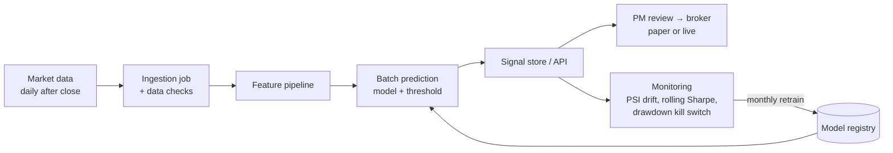

# TSLA ML Trading Model: Predicting 5-Day Price Direction

Module 3 Project (SCTP Advanced Professional Certificate in Data Science & AI)

## Project overview and problem statement

An investment desk holds Tesla (TSLA) and must decide each day whether to be **long, flat or short** for the coming week. Today it simply **buys and holds**. This project builds a machine-learning model that predicts whether TSLA's next 20-day return will be:

| Label | Rule |
|---|---|
| Buy (+1) | 20-day return > +6.0% |
| Hold (0) | between −6.0% and +6.0% |
| Sell (−1) | 20-day return < −6.0% |

The model's probabilities, filtered by a confidence threshold, become daily trading signals. They are judged against buy-and-hold on **after-cost risk-adjusted return (Sharpe ratio)** and drawdown, followed by a deploy / don't-deploy recommendation.

**ML problem type:** supervised, multi-class classification on time-series data, with daily batch predictions.

## Dataset

- **Source:** Yahoo Finance daily OHLCV for `TSLA`, split- and dividend-adjusted, via the [`yfinance`](https://pypi.org/project/yfinance/) library
- **Period:** 2012-01-01 to 2026-10-01 
- **Features:** 18 scale-free technical features (returns, moving-average ratios, RSI, price-normalised MACD, Bollinger %B, volatility and volume ratios)
- **Splits (chronological, purged):** train 2012–2020 · validation 2021–2022 · test 2023–2026

**How to obtain it:** the notebook downloads the data automatically on first run and caches it to `data/tsla_ohlcv.csv`. Yahoo data is for personal and educational use, so the CSV is not committed to this repository.

> If the download fails (no internet), the notebook falls back to **synthetic** data and prints a warning. Synthetic results have no real-world meaning.

## Method summary

1. **Baselines:** buy-and-hold (the current process) and a majority-class `DummyClassifier`
2. **Models:** Logistic Regression (scaled, L2), Random Forest, Histogram Gradient Boosting, all with balanced class weights
3. **Tuning:** `GridSearchCV` with `TimeSeriesSplit(n_splits=5, gap=5)` on training data, scored by macro F1
4. **Model and threshold selection** on the 2021–2022 validation set
5. **Single final test** on 2023–2026 after refitting on 2012–2022
6. **Backtest:** signal after the close on day *t*, filled at the close of *t*+1, 0.1% cost per unit of position change
7. **Error analysis** by volatility regime and quarter; permutation feature importance
8. **Opportunity sizing** with a block-bootstrap confidence interval on excess return

**Leakage controls:** backward-looking features only (verified by an automated check), purge gaps between splits, time-series cross-validation with a gap, and a scaler fitted inside a `Pipeline`.

# Results summary (TSLA)

- **Data:** Yahoo Finance (cached), 2013-01-03 to 2026-09-01, 3,436 modelling rows, 18 features
- **Target:** 20-day return > +6.0% = Buy, < -6.0% = Sell, else Hold
- **Selected model:** Logistic Regression (tuned), params {'clf__C': 0.1}, confidence threshold 0.46

| Test 2023-26 | ML strategy | Buy & Hold |
|---|---|---|
| CAGR | 33.2% | 38.6% |
| Sharpe | 0.99 | 0.82 |
| Max drawdown | -39.9% | -53.8% |
| Macro F1 | 30.1% | – |
| Trades | 68 | 1 |

- **Excess return 95% CI:** [-63.48%, +34.43%] per year
- **Recommendation:** DO NOT DEPLOY YET: promising, but the edge is not yet statistically reliable or cost-justified; run paper trading

## Repository structure

```
.
├── tsla_trading_model_v2.ipynb      # full analysis (sections 1–12 follow the assignment brief)
├── requirements.txt
├── README.md
├── data/                         # cached Yahoo download (created on first run, git-ignored)
└── outputs/                      # created by the notebook
    ├── figures/                  # PNG charts for slides
    ├── model_comparison_*.csv    # baseline / tuned model tables (validation)
    ├── validation_vs_test.csv
    ├── test_financial_metrics.csv
    ├── error_by_regime.csv, error_by_quarter.csv
    ├── opportunity_sizing.csv
    ├── feature_drift_psi.csv
    ├── test_signals.csv
    ├── final_model.joblib        # model + threshold + feature list
    └── results_summary.md
```

## Deployment architecture (proposed)



## Disclaimer

Educational project only. This is not investment advice.
